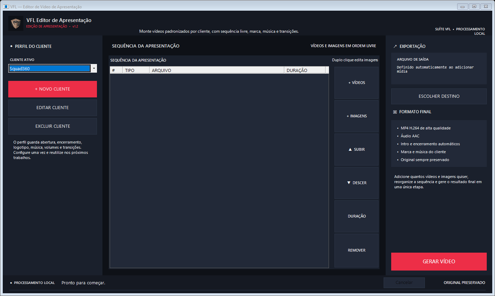

# VFL Editor de Apresentação



## Baixar

Baixe a versão portátil mais recente na página de [releases do projeto](https://github.com/piratabarba-blip/VFL-Editor-Apresentacao/releases/latest). Não é necessário instalar o .NET nem o FFmpeg separadamente.

## Início rápido

Abra `VFL.EditorApresentacao.exe`, crie um perfil de cliente e selecione o vídeo principal. O executável é identificado pelo Windows como **VFL Editor de Apresentação**, inclusive ao ser fixado na barra de tarefas. Todo o processamento é feito localmente no computador.

Aplicativo Windows para salvar um perfil por cliente e gerar automaticamente:

1. abertura em imagem ou vídeo;
2. vídeo principal com logo no canto inferior esquerdo;
3. encerramento em imagem ou vídeo;
4. transições em fade e música de fundo.

## Sequência livre — v1.2

A apresentação pode conter qualquer quantidade de vídeos e imagens, na ordem desejada. Use **Adicionar vídeos** ou **Adicionar imagens**, depois organize com **Subir**, **Descer** e **Remover**. Vídeos usam sua duração original; cada imagem possui uma duração configurável.

Vídeos de abertura e encerramento usam automaticamente sua duração completa. A duração configurável é usada somente quando a abertura ou o encerramento for uma imagem.

O resultado acompanha a resolução e a taxa de quadros do vídeo principal. Os arquivos de origem nunca são sobrescritos. Como fades, logo e mistura de áudio exigem composição, o MP4 final é recodificado em H.264 com qualidade alta (CRF 18).

## Executar durante o desenvolvimento

```powershell
dotnet run
```

O aplicativo procura `ffmpeg.exe` e `ffprobe.exe` em `Tools`, ao lado do executável, ou no `PATH` do Windows.

## Publicar

```powershell
dotnet publish -c Release -r win-x64 --self-contained true -p:PublishSingleFile=true
```

Os perfis ficam em `%APPDATA%\VFL Editor de Apresentacao\clientes.json`.

## Privacidade e distribuição

O pacote público não contém clientes, marcas ou logotipos pré-cadastrados. Cada instalação começa vazia e os perfis criados pelo usuário permanecem apenas no próprio computador.

## Licença

Uso pessoal e não comercial permitido conforme a [PolyForm Noncommercial License 1.0.0](LICENSE.md). Venda, revenda e uso comercial exigem autorização expressa.
